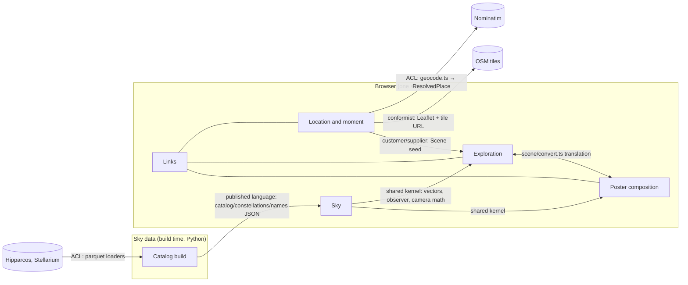

# starsky — domain model

Status: Draft
Updated by backend:domain on 2026-11-01, replacing the introspec reconstruction of 2026-09-29. That version described the retired Gradio app and Python renderer (BCR-0001, BCR-0005).

## Summary

starsky has no backend. Nothing is persisted on a server, there are no accounts, and no state is shared between visitors. The domain still has real rules: what a sky is, what a link may carry, and what may never be drawn. They live in plain TypeScript modules under `site/src/lib/`, independent of React and Canvas (plan non-negotiable), and in the Python data build. This document models those rules.

The aggregates here are not database rows. Each is a versioned, immutable value carried inside a URL fragment (`#c=`, `#e=`, `#studio=`, `#s=`). Its invariants are enforced by the codec that decodes it. The link is the persistence.

Backend-specific sections (authorization, concurrency, retention) are kept, each stating briefly why it is near-empty. `backend:spec` stays N/A for every feature (`specs/README.md`, Backend column), and `contracts/openapi.yaml` stays N/A.

## Inputs used (and missing)

- Used:
  - Code on `dev` at 189c118 (013 and 016 merged): `site/src/lib/{share,sky/*,scene/*,landing/*,studio/*,explorer/link,render/*}.ts`, `site/render-spec.json`, `site/public/data/*.json` and `src/starsky/`.
  - Specs 009–016, BCR-0011–0014, ADR-0006–0008, `specs/009-sky-domain/finding-precision.md` and `docs/product/ux-vision.md`.
- `docs/product/brief.md` is stale. It predates BCR-0011 (it still lists "Studio — not built" and the old landing). See [UPSTREAM GAP 1].
- `docs/product/architecture.md` line "Map tiles: OpenStreetMap, only after the location map opens" no longer holds, since ADR-0008 was amended on 2026-11-01. See [UPSTREAM GAP 2].
- No product metrics or real traffic numbers exist, so the volumes below are design limits, not measurements.

## Event storming list

Actors: **Giver** (P2, builds a sky), **Recipient** (P1, opens a link), **Operator** (builds data, deploys). External systems: Nominatim, the OSM tile server, the Hipparcos/Stellarium source hosts, Cloudflare R2.

Journey A, from the landing to the Explorer (013):
1. Giver: `SearchPlace(query)` on explicit submit → Nominatim → `PlacesFound` or `NoPlaceFound` or `SearchFailed`.
2. Giver: `ChoosePlace(result)` → `PlaceChosen`. `DropPin(lat, lon)` → `PinDropped`, and the place becomes null. `TypeCoordinates(lat, lon)` → `CoordinatesEntered` or `CoordinatesRejected`.
3. Giver: `SetMoment(local datetime, tz)`, `SetTitle(text)` and `SetLimitingMagnitude(m)` → `MomentSet`, `TitleSet` or `TitleRejected(undrawable char)`, and `MagnitudeSet`.
4. Policy: whenever the form changes, the address bar is rewritten to `#c=` with no new history entry (`CreationLinkUpdated`).
5. Giver: `ExploreSky` → `SkyOpened` (an `#e=` with the initial camera and default layers).
6. Read models: map preview, place summary `<place> • <lat> <lon>`, search results list.

Journey B, exploring (009–011, 014):
1. Giver or Recipient: `Rotate`, `Zoom(anchor)`, `ResetView`, `CenterOn(object)`, `Select(HIP|CON)` and `ToggleLayer`. Each produces `ViewChanged`, `ObjectSelected` or `LayerToggled`.
2. Policy: the live link is rewritten to `#e=` with durable view state only, never hover, animation or panel state.
3. Policy: an object below the horizon is shown as "below the horizon" and is never described as observable.
4. Read models: star tooltip "<Name> • Magnitude", the inspector, the horizon-grouped constellation list and the one-line moment strip.

Journey C, from the Explorer to a poster (012, 015, 016):
1. Giver: `CreatePoster` → `DraftSeeded` (`#studio=`, a SharePayload with the scene's place, moment, title and magnitude, and appearance defaults). The camera is stored per tab (`sessionStorage`) for the way back.
2. Giver: `SetAppearance(projection, shape, fisheye, min separation, glow, labels, title)` → `DraftChanged`, which rewrites `#studio=`.
3. Giver: `Export(format: PNG|SVG|PDF, layout: standard|story)` → `PosterExported` or `ExportFailed(format)`. `CopyShareLink` → `ShareLinkCopied` (`#s=`).
4. Giver: `ReturnToExplorer` → `SkyOpened`, using the remembered camera on an exact scene match, otherwise the initial camera.

Journey D, receiving (006, 015):
1. Recipient: `OpenShareLink(#s=)` → `PosterShown`, `LegacyLink` (unknown version), `InvalidLink(detail)` or `TitleAdjusted(removed glyphs)`.
2. Recipient: `ExploreThisSky` → `SkyOpened`. `MakeYourOwn` → `DraftSeeded`. `Export` → as in journey C.

Journey E, operating (002, 005, 008):
1. Operator: `WarmCache` → `CacheWarmed` or `SourceUnavailable` (retried 3 times, then the build fails). `BuildCatalog(mag ≤ 6.5)` → `CatalogBuilt`, which writes `catalog.json`, `constellations.json` and `names.json`.
2. Operator: `Deploy` → `SiteDeployed`, with `index.html` uploaded last, or `DeployFailed`, in which case the previous build keeps serving.

## Context map

- **Sky** (shared kernel, `lib/sky`, `lib/astro.ts`, `lib/skymodel.ts`): vectors, quaternions, observer and horizon, camera projection, and the prepared scene. It has no UI, no storage and no network. Astronomy math is independent of React and Canvas.
- **Location and moment** (`lib/landing`, `lib/geocode.ts`, `lib/time.ts`): turns a typed place, a pin or coordinates, plus a wall-clock time in a zone, into a validated scene seed.
- **Exploration** (`lib/explorer`): camera navigation, layers, selection, visibility and the live `#e=` link.
- **Poster composition** (`lib/render`, `lib/studio`, `lib/caption.ts`): the render contract `render-spec.json` (one implementation), exports, the caption and glyph coverage.
- **Links** (`share.ts`, `sky/payload.ts`, `landing/creation.ts`, `studio/draft.ts`, `encode.ts`): one encoding (canonical JSON → zlib level 9, legacy hash → base64url, no padding), four fragments, each versioned.
- **Sky data** (build time, `src/starsky/`): the source catalogs become published JSON. It opens no socket at run time and renders nothing.

All browser contexts deploy as one static bundle (ADR-0001, architecture "one module per context"). Nothing in the model argues for a different shape.

## Contexts in detail

### Links context

Four aggregates, each one immutable value with a single root. The URL fragment is its identity and its storage.

| Aggregate | Fragment | Root type | Purpose | Decode strictness |
|---|---|---|---|---|
| CreationLink | `#c=` | `Creation` (`landing/creation.ts`) | A pre-filled landing form | Tolerant per field |
| ExplorerLink | `#e=` | `ExplorerPayload` (`sky/payload.ts`) | A sky plus a durable view | Strict, whole payload |
| StudioDraft | `#studio=` | `SharePayload` (`studio/draft.ts`) | A poster being edited | Strict (same codec as `#s=`) |
| ShareLink | `#s=` | `SharePayload` (`share.ts`) | The canonical poster artifact | Strict, version-migrated |

Invariants:

- **All four:**
  - Must always carry `v: 1`.
  - An unknown version must never be guessed at. It is "legacy" for `#s=`, rejected for `#e=` and `#studio=`, and gives a blank form plus a notice for `#c=`.
  - Must never exceed 4096 fragment characters.
  - Must always round-trip byte for byte through canonical JSON.
- **ShareLink:**
  - Must stay byte-compatible with every link issued since v1 (plan non-negotiable).
  - Must always reject out-of-range values, never clamp them (BCR-0008).
  - Must always reject a non-date `when_utc`, which would otherwise blank the page.
  - Must never store the export layout (BCR-0012).
- **ExplorerLink:**
  - Must always hold a normalised quaternion: a norm below 1e-6 is rejected.
  - FOV must be in [5, 120].
  - `layers.below` must be `hidden` or `dimmed`.
  - `sel` must match `HIP:<n>` or `CON:<abbr>`.
  - Must never carry pointer, hover, animation or panel state.
- **CreationLink:**
  - A field that fails the form's own rule is dropped, and the rest still pre-fill.
  - It must never trigger a geocoder call.
  - It must never add a history entry, since it is written by `replaceState`.
- **StudioDraft:**
  - Must never overwrite a ShareLink. They are separate fragments, so a draft can't replace the artifact.
  - An undrawable title is adjusted, and the visitor is told.

### Location and moment context

- **Aggregate LandingForm** (`landing/state.ts`, a typed reducer; transient, in memory, mirrored to `#c=`).
  - Members: `LandingLocation{lat, lon, place, source: default|search|pin|typed}`, moment, title and limiting magnitude.
  - Invariants:
    - Must never leave the page (`ExploreSky`) with an invalid coordinate, an empty moment or an undrawable title.
    - A dropped pin must always clear the place name. The place shown must belong to the coordinates.
    - The pin and the coordinate fields must always agree.
- **Value objects:**
  - **Coordinates:** lat in [-90, 90] and lon in [-180, 180]. Longitude is normalised on input and rejected in links.
  - **ResolvedPlace:** `display_name`, lat and lon from Nominatim.
  - **LocalMoment:** `YYYY-MM-DDTHH:mm` plus an IANA zone, converted to an instant by `zonedTimeToUtc`.
  - **Instant:** UTC `YYYY-MM-DDTHH:MM:SSZ`.
  - **Title:** at most 200 characters, and every glyph must exist in the bundled poster face (BCR-0007).
  - **LimitingMagnitude:** [1, 7] in poster and creation links, [-2, 12] in `#e=`. It is clamped to [1, 7] when a scene crosses into a poster.
- **Lifecycle: PlaceSearch** (`landing/search.ts`):
  - States: `idle → loading → results | empty | error`.
  - `submit` moves any state to `loading` (or straight to `results`/`empty` on a cache hit).
  - `cancel` (a place is chosen or the field is cleared) moves any state to `idle`.
  - `dispose` is terminal.
  - A new query aborts the request in flight, so a late response is dropped and never shown.
  - Illegal transitions:
    - From `results` to `loading` without a new query.
    - Emitting anything after `dispose`.
    - Any request started by typing alone (Nominatim policy, issue #65).

### Exploration context

- **Aggregate ExplorerView** (`explorer/controller.ts`; transient, mirrored to `#e=`).
  - Members: the camera (quaternion camera→world, FOV), the layers, the selection, and an `ObservationContext{lat, lon, when}`.
  - Invariants:
    - FOV must always be clamped to [5, 120], with 100 as the default.
    - The equatorial frame is fixed (ADR-0006).
    - An object whose altitude is ≤ 0 must never be presented as observable. It is "below the horizon", hidden or dimmed by `layers.below`.
    - A constellation is associated only through figure lines (owner decision 7).
    - Reset and centre glide by slerp, and must end exactly on the target camera.
- **Lifecycle: ExplorerChrome** (`explorer/chrome.ts`):
  - States: `shown ⇄ collapsed`.
  - It collapses after 4000 ms idle, unless held by a popover, focus, pointer, pin or drag.
  - It starts collapsed on load.
  - Illegal: collapsing while a hold is active.
- **Read models:**
  - The horizon-grouped constellation list.
  - The star tooltip, after a 1.5 s hover.
  - The inspector.
  - The adaptive metadata line.
  - The live link.

### Poster composition context

- **Aggregate Poster**: a derived value. It renders `SharePayload + SkyModel + format`, and nothing is persisted.
  - Invariants:
    - There must always be exactly one render implementation, governed by `render-spec.json`, with no magic numbers (constitution II).
    - Circle output must stay byte-stable against its reference images.
    - The square fills the square, inscribed in the horizon (BCR-0014).
    - The story layout is 1080 × 1920 with the standard poster unchanged inside it (BCR-0012).
    - The poster must never draw sky below the horizon.
    - The caption must never be drawn in a substitute face. A missing font withholds the poster (BCR-0007).
    - The preview, PNG, SVG and PDF must agree (one geometry function).
- **Value objects:**
  - **RenderOptions:** projection `stereographic|fisheye`, shape `square|circle`, fisheye strength [0.1, 3], min separation [0, 0.05], magnitude [1, 7], glow intensity [0, 3], plus booleans.
  - **PosterFormat:** `standard|story`.
  - **Caption:** title plus detail line, from the same formatter the UI uses.
- **Lifecycle: Export**:
  - States: `idle → working → done | failed(format)`.
  - A failure names the format and leaves the poster untouched.
  - Illegal: a partial file reported as success.

### Sky context (shared kernel)

- **SkyScene** (`sky/scene.ts`): the immutable catalog prepared once per page.
  - 8,870 stars at mag ≤ 6.5. Each has an id `HIP:<n>`, a unit vector and an optional proper name (520 names).
  - 88 constellations with 843 segments, id `CON:<abbr>`.
- **ObservationContext** and the derived zenith, north and alt/az. GMST is the one sidereal implementation (`astro.ts`).
- **Accepted precision limit:** catalog epoch J1991.25, no proper motion, no precession or nutation (ADR-0006).
  - Measured error is about 0.02° near 2000 and about 1° in 1900 (`finding-precision.md`).
  - This is poster-grade and documented, not hidden.

### Sky data context (build time)

- **CatalogBuild:** Hipparcos (public domain) plus Stellarium modern lines (CC BY-SA 4.0) become parquet caches, then JSON.
  - Invariants:
    - The build is deterministic for the same sources.
    - The magnitude limit defaults to 6.5 (owner decision 6).
    - Names are keyed by HIP.
    - A failed source fails the build, and no partial site is deployed.

## Policies and business rules

| Rule | Source | Enforced in | Test idea |
|---|---|---|---|
| Below-horizon objects are never shown as observable | Plan non-negotiable | `sky/observer.horizonStatus`, `explorer/visibility.ts`, poster cull `alt>0`, 016 inscribed square | Unit: an alt ≤ 0 star is labelled below; reference: square corners on the horizon |
| `#s=` byte-compatible forever | Plan non-negotiable; BCR-0011 | `share.ts` + `standard-pin.test.ts` | Pinned fragments decode; pinned SVG hashes |
| Reject, don't clamp, shared values | BCR-0008 | `share.ts validateOptions` | Out-of-range fragment → InvalidState |
| A draft never overwrites the artifact | ux-vision; 012 | Separate `#studio=` and `#s=` | e2e: editing in the Studio leaves `#s=` unchanged |
| Title glyphs must exist in the poster face | BCR-0007 | `render/glyphs.ts`, landing and Studio validation, Viewer adjustment | e2e `undrawable-title.spec.ts` |
| One render implementation, values from the spec | Constitution II | `render-spec.json`, `spec.ts` | `spec.test.ts`, references |
| Export layout never stored in a link | BCR-0012 | ExportControls state only | Unit: payload has no format key |
| Viewer shows the image and its heading only | BCR-0013 | ViewerPage | e2e `identity.spec.ts` |
| Square fills the square, inscribed | BCR-0014 | `render/poster.ts skyExtent` | Reference `sydney-xmas-square.png` |
| Search Nominatim only on explicit submit, ≤ 1 request/s, cache repeats | Nominatim policy S1 | `landing/search.ts` (issue #65, fixed: typing sends nothing, blur with new text submits, 1 s spacing, session cache) | Unit: typing sends nothing; e2e: request count |
| Tiles only for the visible view, attribution always visible, Referer kept | OSM tile policy S2; ADR-0008 | Leaflet config, `map-config.ts`, no Referrer-Policy | e2e `landing.spec.ts`, `network-guard.spec.ts` |
| Tests never contact real tile or geocoder servers | Constitution 1.2.0; ADR-0008 | e2e fixtures fail on unstubbed hosts | `network-guard.spec.ts` |
| Copy agrees with ux-vision both ways | AGENTS.md | `check_i18n_keys.py` | CI gate |

## Authorization model

There is one actor class: an anonymous visitor in their own browser. Every command in the event-storming list is available to every visitor. There is no object ownership, because a link is a capability: whoever holds it can render it, and nobody can change what someone else holds. The Operator acts only through CI and deploy credentials (secret names in `delivery.md`), outside the app.

| Actor | Landing commands | Explorer commands | Studio and export | Open `#s=` | Data build, deploy |
|---|---|---|---|---|---|
| Visitor (giver or recipient) | ✓ | ✓ | ✓ | ✓ | — |
| Operator (CI) | — | — | — | — | ✓ |

## Read models and access patterns

Everything is computed in the browser from the static JSON (about 132 KB brotli) and the fragment. There are no queries over a network except Nominatim search (one per explicit submit) and the map tiles in view on the landing.

| Read model | Inputs | Target latency |
|---|---|---|
| Visible stars and segments for a camera | SkyScene + camera + observer | One frame (16 ms) while dragging |
| Poster model | SharePayload + catalog | Under 1 s on mid phones [ASSUMPTION] |
| Constellation list grouped by horizon | Scene + observer | On load and on time change |
| Search results | Nominatim, at most a handful | Network-bound; cancellable |

## Consistency and concurrency

Nothing is shared between visitors, so there is no contention point. Within a tab:

- A newer search aborts the older one, so the latest query wins.
- Each live link is rewritten from the current state, with no queued writes.
- The return camera in `sessionStorage` is used only on an exact scene match. Storage that is missing or throws means the initial view.

## Data ownership, privacy and retention

| Data | Owner context | Classification | Where it goes | Retention |
|---|---|---|---|---|
| Typed place text | Location | Personal-ish (can reveal a home address) | Only to Nominatim, from the visitor's browser, on submit | Not stored by starsky; Nominatim's own policy applies |
| Coordinates, moment, title | Links | Personal when they describe a person's home or date | Only inside the visitor's own URL fragment, which is never sent to the starsky host (fragments are not part of HTTP requests) | As long as the holder keeps the link |
| Visitor IP + Referer | — | Personal data under GDPR/LGPD (S3) | To Nominatim (on search) and the OSM tile server (landing map), plus R2 access logs (static files) | Third-party policies; R2 per Cloudflare |
| Return camera | Exploration | None | `sessionStorage`, this tab only | Until the tab closes |
| Star catalog, names, lines | Sky data | None (public domain; CC BY-SA 4.0 attributed) | Public static files | Versioned with releases |

Not legal advice. The brief's "Compliance: N/A" still fits, because starsky collects nothing. But two third parties (OSM tiles, Nominatim) see the visitor's IP once they use the landing. A short privacy note in the app or docs would make that visible ([UPSTREAM GAP 3]). Confirm with counsel if needed.

## Integrations

| System | Direction, mode | Anti-corruption | Idempotency | Failure behaviour |
|---|---|---|---|---|
| Nominatim search | Browser → OSM, sync fetch, cancellable | `geocode.ts` maps results to `ResolvedPlace`; Referer identifies the app | Read-only; repeat queries are cached for the page session, 1 request/s (#65) | Inline "couldn't search" message; coordinates still work; nothing navigates |
| OSM tiles | Browser → OSM, on view (landing only) | Leaflet; URL in one config value | Read-only, browser-cached per headers | Failure shown in the map's box; search and coordinates still work |
| Hipparcos / Stellarium hosts | CI → sources, build time | Parquet loaders (`src/starsky/data`) | Cache warm reruns safely | 3 retries, then the build fails with no deploy |
| Cloudflare R2 | CI → bucket | `site_r2.yml` | Re-upload overwrites, `index.html` last | Failed deploy leaves the previous build serving |

## Volumes

There are no measured numbers; these are design limits from the budgets and the catalog.

- **Catalog:** 8,870 stars, 843 segments, 88 constellations and 520 names, fixed per release.
- **Bundle:** 390 KB brotli against a 500 KB budget. The data is 132 KB against 400 KB. Leaflet is a lazy chunk of 49 KB gzip.
- **Fragment:** at most 4096 characters. A typical `#s=` is about 250–350 characters.
- **Nominatim:** at most 1 request/s per visitor, on explicit submit only (#65).
- **Tiles:** one view's worth, about 6–20 tiles per map position. The e2e guard asserts fewer than 40.
- **Traffic:** unknown [ASSUMPTION: low, hobby scale; the OSM best-effort policy is the binding limit if it grows].

## Open questions

1. Should the app show a one-line privacy note (place text and IP reach OpenStreetMap only when you search or view the map)? Owner decision.
2. Metrics remain undefined (brief open item).
3. If traffic grows, the evolution trigger for a self-hosted geocoder or tiles needs a number (architecture evolution path).

## Upstream gaps

1. [UPSTREAM GAP 1: `docs/product/brief.md` predates BCR-0011 and 012–016. Its capabilities, glossary and landing description are out of date. Owner: project:init. Proposed fix: refresh the brief during hardening #55. I appended the new glossary terms per the append-only rule.]
2. [UPSTREAM GAP 2: `docs/product/architecture.md` decision row "Map tiles … only after the location map opens" contradicts amended ADR-0008. Owner: project:architecture. Proposed fix: "only on the landing page, visible view only".]
3. [UPSTREAM GAP 3: no visitor-facing privacy note about third-party calls. Owner: frontend:uiux and docs. See open question 1.]

## Coverage checklist

- [x] Every brief journey, plus the new Explorer, Studio and landing journeys, appears in the event-storming list.
- [x] Every status-bearing entity (PlaceSearch, ExplorerChrome, Export, link decode) has a state machine with its illegal transitions.
- [x] Every aggregate has must-always/must-never invariants.
- [x] Every rule has a source and an enforcement point.
- [x] Every command has an actor (the anonymous visitor or CI).
- [x] Time, coordinates, magnitude, title and identifiers are value objects with rules. There is no money in the domain.
- [x] Every data item has an owner, a classification and a retention rule.
- [x] Every integration has a failure behaviour.
- [x] Reviewed against the modeling tells; see the decision log.

## Decision log

- **2026-11-01:** rewritten from code. The introspec model (one "Poster generation" context, Gradio, Python renderer) was replaced by six contexts and four link aggregates.
- **Modeling-tells review:**
  - CRUD everywhere: not present (no storage).
  - Anemic model: avoided, because invariants sit in the codecs and reducers, not in components.
  - Noun-per-service: N/A (one bundle).
  - Free-string status: the search, export and chrome states are discriminated unions.
  - Revision made: link decode strictness was stated per aggregate, because `#c=` is deliberately tolerant while the other three are strict.
- **2026-11-01:** the review surfaced a Nominatim policy violation (search-as-you-type). It is tracked as issue #65 and recorded as a rule above rather than modelled as acceptable.

Sources:

- S1: Nominatim usage policy. "Auto-complete search … must not implement such a service on the client side", "maximum of 1 request per second", results must be cached, Referer or User-Agent identification, attribution. https://operations.osmfoundation.org/policies/nominatim/, retrieved 2026-11-01.
- S2: OSM tile usage policy. Exact URL, visible attribution, Referer not stripped, no prefetch or offline, honour caching. https://operations.osmfoundation.org/policies/tiles/, retrieved 2026-11-01.
- S3: IP addresses as personal data. GDPR Recital 30 lists online identifiers such as IP addresses (https://gdpr-info.eu/recitals/no-30/). LGPD Art. 5 I defines personal data as information about an identified or identifiable natural person (https://www.planalto.gov.br/ccivil_03/_ato2015-2018/2018/lei/l13709.htm). [ASSUMPTION: not re-fetched this session; standard references.]
